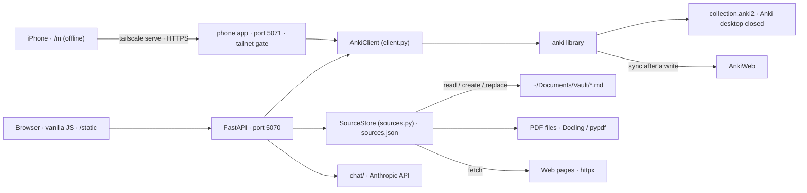

# Overview

> Map of the system for the maintainer. The README covers usage; each spec covers one concept end-to-end. **Specs are the source of truth: edit the spec first, then the code.**

## What the app does

A personal, local web app to **empty the queue of flagged Anki cards efficiently**, deck by deck. For each deck the user sees the flagged [notes](./notes.md), the deck's [sources](./sources.md) (Obsidian notes, PDFs, web pages) side by side, and, once a note is opened in the [workspace](./workspace.md), a [conversation with Claude](./chat.md) that reads the deck's notes and sources on demand and proposes edits, splits and creations that land on the workspace as versions and cards. Everything is written into Anki's collection by the app itself, in one validation per workspace.

The user flags a card during an Anki review when something is wrong with it (too vague, wrong deck, should be split, needs a sibling card…). The reason is often typed into the note's `Back Extra` field ([notes.md § Reason](./notes.md#reason-back-extra)). This app is where those flags get resolved.

## Specs

| File | Concept |
|---|---|
| [notes.md](./notes.md) | Note, card, note type, field, reason, field syntax |
| [review.md](./review.md) | The three-column page: deck tree, queue, decisions, rendering, keyboard |
| [priority.md](./priority.md) | Priority queue: urgency criteria, study-deck budget filtering, deck tree row |
| [sources.md](./sources.md) | Corpus, source, anchors, extracted text, vault writes, Source tab |
| [workspace.md](./workspace.md) | The overlay: cards, versions, split, flag toggle, validation, undo |
| [chat.md](./chat.md) | The conversation: system prompt, guidelines, read tools, proposal tools, source proposals |
| [theme.md](./theme.md) | Visual identity: terminal look, Omarchy palettes, two-layer colour architecture, picker, logo |
| [mobile.md](./mobile.md) | Phone app: batch, Anki day, precomputed outcomes, phone queue, pending actions, sync, review log, tailnet gate |

## Architecture

**Where things are stored.** Anki is the store for notes; `sources.json` is the store for corpora and anchors; `guidelines.md` is the store for the chat's [guidelines](./chat.md#guidelines); `review_log.jsonl` and `mobile_actions.jsonl` hold the phone's [review log](./mobile.md#review-log) and the action ids already synced; the workspace and its conversation live in browser memory and are dropped when the workspace closes. No database.

**Who writes to Anki.** Three paths only: « Keep » in the queue clears a flag ([review.md § Decisions](./review.md#decisions)); the workspace's « Apply » writes all its changes or none, with snapshot and rollback ([workspace.md § Validation](./workspace.md#validation)); a phone [sync](./mobile.md#sync) replays answers, sets or clears the orange flag, suspends, and re-dates replayed cards. The server keeps one snapshot for « Undo last validation ».

**How the app reaches Anki.** See [Anki](#anki) below.

**Who writes to the vault.** Two operations only, both behind a user click: create a file, replace a passage ([sources.md § Writing to the vault](./sources.md#writing-to-the-vault)).

**Single user, Mac plus phone.** No login. One process listens on two ports, both bound to `127.0.0.1`: the main app on `5070`, the phone app alone on the [phone port](./mobile.md#tailnet-gate) `5071`. Only the phone port is exposed on the tailnet, through `tailscale serve`, and its tailnet gate refuses every request that does not carry the owner's Tailscale login.

## Anki

The **anki library** is Anki's own Python package (`anki` on PyPI), the code Anki desktop runs: it opens a collection file inside the calling process. It is a dependency pinned to Anki desktop's version (`anki==26.9.2`); the two are bumped together.

The **collection** is the file Anki desktop keeps for the profile, `collection.anki2`, with its media folder `collection.media` beside it. Env `ANKI_COLLECTION` is its path; unset, the app takes the only profile's under `~/Library/Application Support/Anki2/`. The app never creates a collection: a path with no file is an error.

**AnkiClient** (`client.py`) is the app's typed client for Anki: every read and write of the app goes through it, as anki library calls on the open collection. Its operations are named after what they do (`cards_info`, `update_note`, `set_flag`, `answer_card`…); the routes, `review.py`, `workspace.py` and `mobile.py` call nothing else. A media file is read straight from the media folder, without opening the collection.

The **collection lock** is Anki's exclusive hold on a collection file while one process has it open: no other process can open it until it is closed. Anki desktop holds it from the moment the profile is loaded until it is closed, so the app and Anki desktop **take turns** on the file.

The **holding policy** is when the app opens the file and closes it again: it opens it for one **action** — one HTTP request, one CLI command, one chat [read tool](./chat.md#read-tools) call — and closes it when the action is done. Opening takes a few milliseconds. An action that wrote keeps the file open for one more step, its [AnkiWeb sync](#ankiweb-sync), run in the background after the app has replied, and closes it when that sync ends. Another action arriving meanwhile waits for the file, then runs. So:

| Situation | What happens |
|---|---|
| Anki desktop open, the app acts (a click, a phone sync) | The action fails and writes nothing: `503` with `Close Anki desktop first`. Closing Anki desktop and retrying works. |
| The app running, Anki desktop opened | It opens normally, unless an app action or the AnkiWeb sync after it is running at that instant: then Anki desktop says the collection is already open, and a retry works. |
| A phone sync while Anki desktop is open | Fails like any action; the phone keeps its pending actions for the next sync. |

### AnkiWeb sync

The app and Anki desktop sync with AnkiWeb as **one device**: they share one file, and the sync state (which changes are uploaded, when the last sync ran) lives in that file. Anki marks each change it writes as not yet uploaded, and whoever syncs the file next sends the marked changes and clears the marks, so the two never conflict with each other.

The **AnkiWeb sync** is the sync the app itself runs after an action that wrote (a validation, a flag, a phone sync's replays), so that the other devices get the change within seconds with Anki desktop closed: one `sync_collection` on the still-open collection, then its media, in the background after the reply, then the file is closed. A failed sync (no network, AnkiWeb down) leaves the changes marked; the next sync, the app's or Anki desktop's, sends them, so nothing is lost.

The login is not in the file (Anki desktop keeps its own in its profile). The app logs in once with `uv run anki login`, which keeps the key AnkiWeb returns in `.env` as `ANKIWEB_HKEY` (and `ANKIWEB_ENDPOINT` when AnkiWeb names one), never the password. Without `ANKIWEB_HKEY` the app runs no AnkiWeb sync, and Anki desktop sends the app's changes at its next sync.

A **full sync** replaces one side's whole collection with the other's; Anki requires one after a schema change, such as the note-type change a validation or its undo can make. The app reads whether the file's schema changed since the last sync when it opens the file, before writing:

| What the sync answers | What the app does |
|---|---|
| no changes, normal sync | Done. |
| full upload (AnkiWeb holds nothing) | Uploads: nothing to lose. |
| full sync, schema unchanged at open and changed by the app's write | Uploads: the Mac's file wins; answers given on other devices since the last sync are lost. |
| full sync otherwise (Anki desktop changed the schema and did not sync, or another device forced it), full download | Sends nothing, and records « AnkiWeb needs a full sync: open Anki desktop to choose » as the sync's status; the app's writes stay in the file, unsent, until Anki desktop settles it. |

The outcome of the last AnkiWeb sync is kept in memory and a failure is logged in the server's output.

### Undo

The workspace's « Undo last validation » stays the app's own snapshot ([workspace.md § Undo](./workspace.md#undo)): Anki's own undo list lives in the open collection and is lost at each close.

## Module map

| Path | Role | Spec |
|---|---|---|
| `src/anki_assistant/client.py` | `AnkiClient`: the collection through the anki library, holding policy | [§ Anki](#anki) |
| `src/anki_assistant/models.py` | `Card`, `Note` dataclasses | — |
| `src/anki_assistant/sources/` | `SourceStore`, corpora, anchors, text extraction, vault writes | [sources.md](./sources.md) |
| `src/anki_assistant/pdf_cache.py` | Sidecar cache, structural index, Docling extraction | [sources.md](./sources.md) |
| `src/anki_assistant/review.py` | Note-level view of a deck, primitive writes, priority queue | [review.md](./review.md), [priority.md](./priority.md) |
| `src/anki_assistant/workspace.py` | Validation: plan, snapshot, ordered writes, rollback, undo | [workspace.md](./workspace.md) |
| `src/anki_assistant/chat/` | Prompt assembly, Anthropic call, tools, SSE streaming | [chat.md](./chat.md) |
| `src/anki_assistant/mobile.py` | Anki day, batch building, sync (replay, re-dating, dropped actions, review log) | [mobile.md](./mobile.md) |
| `src/anki_assistant/cli.py` | CLI over the same client (debugging tool, not specced) | — |
| `src/anki_assistant/web/main.py` | App factories (main app, phone app), static mount, router includes, port dispatch, entry point serving both ports | [mobile.md](./mobile.md#tailnet-gate) |
| `src/anki_assistant/web/routes_review.py` | `/api/decks`, `/api/notes…`, `/api/notes/priority` | [review.md](./review.md#api), [priority.md](./priority.md#api) |
| `src/anki_assistant/web/routes_workspace.py` | `/api/workspace/apply`, `/api/workspace/undo` | [workspace.md](./workspace.md#api) |
| `src/anki_assistant/web/routes_sources.py` | `/api/sources…`, `/api/vault/notes` | [sources.md](./sources.md#api) |
| `src/anki_assistant/web/routes_chat.py` | `/api/chat` (SSE) | [chat.md](./chat.md#api) |
| `src/anki_assistant/web/routes_mobile.py` | `/api/mobile/batch`, `/api/mobile/sync`, `/api/mobile/media/{filename}`, the page under `/m`, the phone port's shell files | [mobile.md](./mobile.md#api) |
| `src/anki_assistant/web/gate.py` | Tailnet gate middleware (phone app only) | [mobile.md](./mobile.md#tailnet-gate) |
| `src/anki_assistant/web/render.py` | Field display transform | [review.md](./review.md#rendering) |
| `src/anki_assistant/web/errors.py` | Error mapping; holds the collection for one request | [review.md](./review.md#api) |
| `src/anki_assistant/web/templates/index.html` | The main app's page | — |
| `src/anki_assistant/web/templates/mobile.html`, `mobile-sw.js` | The phone page and its service worker | [mobile.md](./mobile.md#phone-page) |
| `src/anki_assistant/web/static/` | Frontend: vanilla JS, no framework, no bundler; `mobile*.js`, `mobile.css` are the phone page's | [review.md](./review.md#frontend), [theme.md](./theme.md), [mobile.md](./mobile.md#phone-page) |
| `tests/` | pytest, each test on a temporary collection: an empty collection it creates in its temp folder with the anki library (`tests/anki_fixture.py`), never the user's | — |

## Conventions

English UI copy, code and specs.
